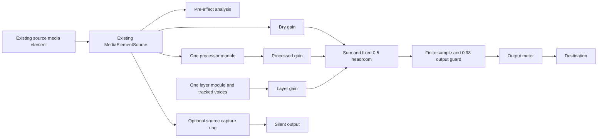

# Shared audio research foundation

18 November 2026. Implemented and validated in `/Users/pmarko.alt/.codex/worktrees/room-listening-prototypes/room.haus` from base `9b4ae30` (the completed listening host, following merged Underlevel). Prepared for review on `codex/audio-research-foundation` against master after the listening host merged. The existing untracked prompt pack is preserved separately. No deployment or public-season integration is included.

## What is available

The existing ListeningSession → AudioController → HLSAudioSource owner now supports explicit `{research:true}`. The development **Audio routing check** launcher is under **Audio experiments**. It is an integration reference, not a seventh themed experiment. It uses a reversible low-pass and one quiet generated kit hit; the six baselines should supply their own modules through this foundation.

The public player, Underlevel and three visual-only interactibles use the original default path. There is one source element and one context in an opted-in session. Native WebKit HLS keeps its native output and exposes unavailable research capabilities. Do not infer processing availability from the analysis live/ambient/inactive state.

**Source identity:** `artifacts/audio-research/source-manifest.json` records the validated local snapshot's base revision, branch and SHA-256 hashes of the actual source/API, worklet and integration files. Dependencies must compare those files rather than assume the implementation exists in another checkout. The prompt pack is not the implementation.

## Ownership and routing



HLSAudioSource installs this instead of its direct destination connection, never alongside it. Analysis remains on the original source tap, without processed/layer feedback. Research Original and Processed both have fixed gain0.5 (−6.0206dB); dry/processed crossfade is linear. Layer level is additionally capped at half the effect level. The finite-sample worklet replaces NaN/Infinity with0 and clips final samples at±0.98 (−0.1755dBFS). This is a safety guard, not mastering or a loudness normalizer. Do not drive into the ceiling as an effect.

During worklet initialization, a built-in WaveShaper preserves Original with the same headroom. Processing/layering stay disabled until the worklet guard is available. A guard initialization/error failure returns to this Original path. Native WebKit HLS and missing Web Audio never create this graph: the existing native source remains audible at its original level. Those paths cannot offer a matched Processed comparison.

Modules are trusted local code, not sandboxed plugins. Never connect a module directly to destination, create a context/media owner, or bypass the shared buses. Call `scope.own(node)` for every node, and return a disposal function for non-node resources. Do not use module code for transport.

## Exported interfaces

Paths are relative to this checkout.

| Export | Location | Contract |
| --- | --- | --- |
| `ListeningSession(url, {research:true})` | `src/experiences/shared/ListeningSession.ts` | Opt-in owner; use existing play/pause/seek/snapshot/dispose. `session.audio.research` provides the extension. No options retains the old path. |
| `ResearchAudio` | `src/experiences/shared/audio/research/ResearchAudio.ts` | Owned and disposed by AudioController. Consumers use the existing instance. |
| `ModuleFactory`, `ModuleScope`, `ResearchModule`, `ModuleKind` | same | Factory receives `{context, own(node), clock}` and returns `{input?, output, update?, reset?, dispose?}`. Processor requires an input; layer is source-only. |
| `ramp(param, value, audioTime, duration=.015)` | same | Finite targets only; holds/cancels prior automation and ramps over15ms. Has a fallback for browsers without cancelAndHoldAtTime. |
| `AudioClock`, `HORIZON` | `.../research/AudioClock.ts` | One owner timer,100ms horizon, manual tempo and phase. |
| `ResearchHost` / `ResearchHostProps` | `.../research/ResearchHost.tsx` | Plain listening host; props title/description/configure/onClose and optional controls render function. Uses existing modal, no simulation or renderer. |
| `kitNames`, `makeSamples`, `makeReference`, `toBuffer`, `wavBytes` | `.../research/materials.ts` | Shared deterministic source material. `toBuffer` expects the generator's24kHz data; `wavBytes` accepts an explicit rate. |
| `referenceProcessor` | `.../research/reference.ts` | Development low-pass only; module example, not Task01. |

### ResearchAudio operations

- `install(kind: 'processor' | 'layer', factory)`: stop existing experiment output, retain a factory for that slot. At most one factory per kind. Creation is deferred until arm.
- `update(kind, params: Record<string,number>)`: cache finite numeric values and update an active module. Modules must clamp their meaningful ranges. An update/create exception returns to Original.
- `arm(): boolean`: creates scoped modules and crossfades into Processed only while source status is **playing**, context is running, guard exists and tab is visible. Returns false on unavailable/failure. A short retirement bound can reject rapid programmatic re-arms; retry after cleanup.
- `setLevel(0..1)`: smooth dry/processed balance plus layer level. This is not source volume or normalization.
- `original()`, `stop(reason?)`, `reset()`: return to Original; cancel clock generations/voices, erase capture, ramp output gates to zero15ms, retire module nodes after25ms. Stop acts through owner gates independently of module cleanup. Reset clears state, not the source time. Host configure restores the reference's default settings; other hosts must explicitly restore their own settings if desired.
- `playBuffer(buffer, audioTime?, level=.2): boolean`: tracked one-shot on layer bus. Requires armed/running; max16 active **plus retiring** voices, duration≤8s, level≤0.5, scheduling≤100ms ahead. No loop or unbounded future queue. Raw `AudioBufferSourceNode` work owned inside a module must be bounded/disposed by that module; use this helper for kit/capture playback.
- `startCapture(seconds=4, tap='source'|'output'): boolean`: explicitly start one bounded ring. Source tap is before processing/headroom and preserves finite source samples. Output tap is after guard and useful for local diagnostic renders.
- `capture(seconds=4): Promise<AudioBuffer|null>`: snapshot the newest bounded window, stereo at context rate. Only one pending read;1s timeout. No available samples, cancellation or stale generation returns null. Nothing is played automatically.
- `clearCapture()`: erase both taps and cancel all pending reads.
- `diagnostics()`: separate processing/layering/capture booleans, capture-active, mode/reason, sampled peak/RMS, headroom, active voice/module counts, subscriptions/generation and tempo/phase state. Peak/RMS describe recent worklet blocks, not integrated loudness or a true-peak meter.
- `dispose()`: controller-owned final cleanup. Experiment UI should dispose the session, not independently destroy its context. `attach/detach/sync` are source/controller integration hooks.

Example processor (no new owner):

```ts
const session = new ListeningSession(mixUrl, {research:true});
const research = session.audio.research!;
research.install('processor', ({context, own}) => {
  const filter = own(context.createBiquadFilter());
  filter.type = 'lowpass';
  filter.frequency.value = 700;
  return {
    input: filter, output: filter,
    update: p => ramp(filter.frequency, Math.max(100, Math.min(12000, p.cutoff ?? 700)), context.currentTime),
  };
});
session.play(); // from the user gesture
// After diagnostics().processing and source status playing:
research.arm();
research.original(); // source clock continues
session.dispose(); // modal close
```

### Shared clock

The owner calls `clock.sync(audioTime, mediaTime, running)` every25ms, independently of visual rendering and reduced motion. Timing maps a media-time grid onto AudioContext.currentTime. A media/audio progression disagreement greater than150ms invalidates the phase and stops effects; buffering/pause/seek also cancel immediately through the source lifecycle. It is intentionally conservative with uncertain clocks.

`setTempo(bpm)` clamps40–240 and establishes manual tempo. It cancels prior scheduling and invalidates phase. `tap(mediaTime)` uses up to five taps (intervals0.25–1.5s) and establishes tempo/phase; there is no automatic beat-grid claim. `anchor(mediaTime)` deliberately establishes phase for an already set tempo. The host's Anchor quiet pulse establishes its displayed manual tempo then anchors at the current playhead.

`repeat(beatDivision, (audioTime,generation,gridIndex)=>...)` accepts0.25–16 beats and at most four subscriptions. The additive third argument (Task03) is the existing integer index relative to the current anchor and requested division; two-argument consumers remain compatible. Callbacks schedule only the next100ms. The supplied audio time must be used by a source's `start(time)`, not an animation frame. Duplicate ticks retain the last grid index. A stalled JS thread drops elapsed beats; it does not replay a backlog. `cancel()` increments generation, clears subscriptions/phase and cancels tracked voices. Tempo remains for deliberate re-anchoring. Context suspension, tab hiding and source interruption require explicit re-arm; there is no auto-resume pulse.

```ts
research.clock.setTempo(120);
research.clock.anchor(session.snapshot().time);
const hit = toBuffer(research.context!, makeSamples('rim'));
const cancel = research.clock.repeat(1, at => research.playBuffer(hit, at, .15));
// Stop/Original cancel this too. Unsubscribe alone cancels future callbacks:
cancel();
```

The existing tempo estimate remains advisory and is not used by this clock. Free-time delay is a processor parameter; manual divisions are `60 / clock.bpm * division` after deliberate tempo setup. Effects requiring other future events must stay within the same100ms scheduling horizon and cancellation generation.

## Lifecycle and capabilities

| Event | Research behavior | Source behavior |
| --- | --- | --- |
| Open | Original, no modules/voices/capture | No autoplay |
| Original / Stop |15ms wet/layer fade; gates and tracked voice stops≤20ms; scoped node cleanup25ms; capture cleared | Continues, no hidden seek/rate change |
| Reset | Same cancellation; clears module state/buffers | Continues |
| Pause / ended / buffering / error | Stop, cancel generations, clear captures; loading cannot re-arm | Existing transport behavior |
| Seek, including native media seeking event | Stop and invalidate phase/capture | Only the requested seek |
| Retry / source selector | Detach/dispose prior graph and async epoch, then start bypassed | Existing owner replaces failed/explicitly selected source |
| Hidden tab / context suspension | Stop, no backlog or automatic re-arm | No forced source seek or rate change |
| Close | Dispose modules, retired nodes/voices, timer, listener, message ports, pending reads; close existing context through source | Pause and remove src; launcher focus restored by modal |

| Source/browser | Processing / layers | Capture | Evidence / limit |
| --- | --- | --- | --- |
| Chromium and Android Chromium emulation, processable CORS source | Yes after guard loads | Yes at≤96kHz | Real MediaElement WAV fixture through HLS attachment, real generated tone graph and local renders exercised. Actual HLS/CORS samples still depend on source support. |
| WebKit processable regular WAV / generated graph | Yes after guard loads | Yes at≤96kHz | Actual WebKit AudioContext/worklet signal graph exercised in iPhone browser emulation. |
| Native WebKit HLS | No | No | Native attachment/playback preservation exercised with deterministic media fixture; no Web Audio/context was created. Native media-clock progress is not a physical speaker listening test. |
| Missing Web Audio | No | No | Native fixture playback retained. |
| Guard cannot initialize | No | No | Original output measured at the fallback meter; no second source/context. |

Capture is optional and separate from processing. The ring is max8s/stereo/96kHz:6.144MB, allocated only when requested. Each start clears the other tap; at most one read is outstanding. A returned AudioBuffer belongs to the caller; the caller must release it on its own cancellation generation and keep its total retained buffers bounded. No async read completing after interruption is accepted. No automatic export/upload occurs. The reference host exports only the left channel for its tiny diagnostic download; the shared API retains both channels.

## Shared kit and budgets

Provenance/license/parameters: `src/experiences/shared/audio/research/materials.manifest.json`. Original generated approximations, explicitly **not authentic TR-909 recordings**. Kick, snare, clap, closed/open hats and rim are deterministic24kHz mono; same repository MIT license. No third-party sample filenames or purchases. The shared functions are lazy-loaded with the reference; there is no sample network dependency.

`artifacts/audio-research/materials/` contains exported WAVs and a copied manifest. Kit PCM16 WAVs total102,986bytes. The8s120BPM reference loop,440Hz tone and seeded noise are each384,044bytes as PCM16; only the explicitly selected reference source is retained by the host. A selected reference uses≤0.77MB Float32 plus its≤385KB WAV. The named lazy `audio-reference` chunk measured11,936bytes /4,444bytes gzip; shared owner/runtime code is additional. Working ceiling for concept-specific lazy code is40KB gzip; no new dependencies.

## Evidence and limits

Deterministic tests cover unique bounded scheduling, dropped stalls, pause/seek invalidation, invalid tempo, subscription bounds, all six fixture voices, deterministic noise/loop bounds, actual worklet non-finite rejection, bounded ring and stale cancellation. Pre-effect source capture preserves±1 peaks without applying the final output clipper.

Real browser signal-graph results are in `artifacts/audio-research/real-graph-<project>.json`. For a0.2-peak4400Hz sine, Original RMS≈0.07071066 (exactly one dry path at0.5 gain), full550Hz low-pass Processed RMS≈0.00105374 (about−36.5dB relative), and bypass/Stop return within0.001 absolute RMS tolerance. Guard overload remains finite and≤0.980001. The test also checks16-voice admission, retiring-voice rejection, buffering rejection, module construction failure, pending capture cancellation and output restoration after scheduled additions.

Short real shared-path output renders: `artifacts/audio-research/reference-original.wav` and `reference-processed.wav`;4.3s each, generated diagnostic loop with full550Hz low-pass, same headroom, no normalization. `render-measurements.json` records actual peak/RMS. These are reference audio for audition, not evidence of musical enhancement.

Control screenshots are in `artifacts/audio-research/controls-*.png`; desktop and390/768/1440 layouts,200% text, keyboard playback and reduced motion are checked in browser emulation. Native select text can truncate its selected display on narrow screens; its option still contains the full source identity. No physical-device or acoustic listening qualification is claimed.

Automated processing measurements and playback/capability tests are the evidence here. **No human listening review of groove, quality or musical enhancement was performed.** Tasks01–06 must record actual passage listening separately, and must not translate successful numerical checks into an enhancement claim.

Validation: full Node suite121/121 passed; both TypeScript checks, lint, dependency policy and production build passed;99HTTP routes/94assets verified. The audio foundation browser suite passed17 with4 intentional platform skips across Chromium, Android emulation and mobile WebKit. Eighteen focused public-player regressions passed across the same projects (persistent transport, pause/resume/close, pending cancellation, history seek and retry). Twelve additional shared-host/modal/layout regressions passed (unchanged visual-only source, missing Web Audio, failed-download retry and loaded research controls at390/768/1440/200%). The selected internal suite inventory remains separate from public CI:174public+174Labs=348, zero overlap or omissions. Logs and inventory are under `artifacts/audio-research/`.

Independent review identified buffering re-arm and retiring-voice admission defects. Both were reproduced by the actual-graph regression before fixes, then verified green. The final implementation requires status playing/running context and bounds active plus retiring voices. An additional source-capture fidelity regression was red/green for±1 source peaks. No remaining actionable finding was reported by the independent reviewer; this does not replace later musical listening acceptance.

**Dependency status:** the six baselines can now consume the processing, layering, clock, capture and host APIs from the hashed local snapshot for the supported combinations above. Actual rendered module output and native/failure fallback have been exercised. This is technical foundation availability, not approval of any baseline's musical result or broad browser/device qualification. Task01 and Task02 themselves have not been implemented by Task00.

Reproduce locally:

```sh
npm run build
PORT=4217 node scripts/serve.mjs
# In another terminal:
ROOM_TEST_ORIGIN=http://127.0.0.1:4217 npm run test:browser:labs -- e2e/audio-research.spec.cjs --workers=1
ROOM_TEST_ORIGIN=http://127.0.0.1:4217/labs/ node scripts/audio-research-evidence.mjs
```

Preview: `http://127.0.0.1:4217/labs/#audio-experiments`, then Open Audio routing check. The existing Labs client-side gate is unchanged. Final reference renders measure Original RMS0.03785591/peak0.375 and Processed RMS0.03701368/peak0.28018743: about0.20dB RMS difference without normalization. They are intentionally at similar practical levels; perceptual loudness still needs audition.

### Implementation choices and known limits

Task03 local follow-on: ResearchHost has optional `armLabel`, `processedLabel`
and `levelLabel` (existing defaults retained). `armLabel:null` hides generic arming when an experiment provides its own explicit combined start/anchor action. Its controls render props include
`readMediaTime():number`, which reads the existing session snapshot at the user
gesture instead of anchoring to the displayed 100ms snapshot. AudioClock's callback
adds the existing grid index as argument three. No timing algorithm, source route,
bus, voice bound or lifecycle policy changed. The rhythm module owns only kit
buffers, lane masks and elapsed/queued position deduplication; all voice admission
and cancellation stays shared. Details and verification: [additional-rhythm.md](additional-rhythm.md).
The host's unsupported-path meter note also avoids claiming matched guard/headroom
when no research graph is available. The kit manifest records Task03's copied-buffer
attack calibration separately from the unchanged shared sample generator.

Task 01 local follow-on: `ResearchHost` adds optional `showReferenceTools` (default
true), and source replacement remounts its controls to match configured defaults.
The labelled seek refreshes its controlled slider immediately to avoid restoring
the prior playhead on a subsequent change event; source transport APIs are unchanged.
`ramp` now explicitly anchors the current value after cancel/hold, preventing a
later completed-ramp update from starting at an old event time. Signatures and
routing are unchanged; real-render regression and capability evidence are in
[`processing.md`](processing.md). Other modules should continue using the shared
helper rather than implementing their own automation/lifecycle owner.

- One processor slot and one layer slot, not a plugin system. Modules use ordinary Web Audio nodes and must enforce their own feedback/decay/oscillator bounds.
- Generated reference sources are explicitly selected; the configured mix is never silently replaced.
- Ramps are15ms; there is no limiter lookahead or LUFS matching. The sampled peak meter can miss inter-block/intersample peaks. Guard clipping is checked independently.
- Capture is a sample window, not a time-stretch/stem/key detector. Caller-retained buffers are outside the ring's memory budget.
- The existing modal and named lazy loader remain in use, preserving its failed-download/reopen retry mechanism. The reference adds no new transport or lifecycle owner.
- Desktop and mobile results use automated browser emulation and a deterministic source fixture. Native hardware/audio-route behavior and arbitrary third-party HLS/CORS feeds remain source-specific.
- Implementation consulted [AudioWorkletProcessor](https://developer.mozilla.org/en-US/docs/Web/API/AudioWorkletProcessor) and [AudioParam.cancelAndHoldAtTime](https://developer.mozilla.org/en-US/docs/Web/API/AudioParam/cancelAndHoldAtTime) for render-thread and automation behavior; browser capability is still tested at runtime.
