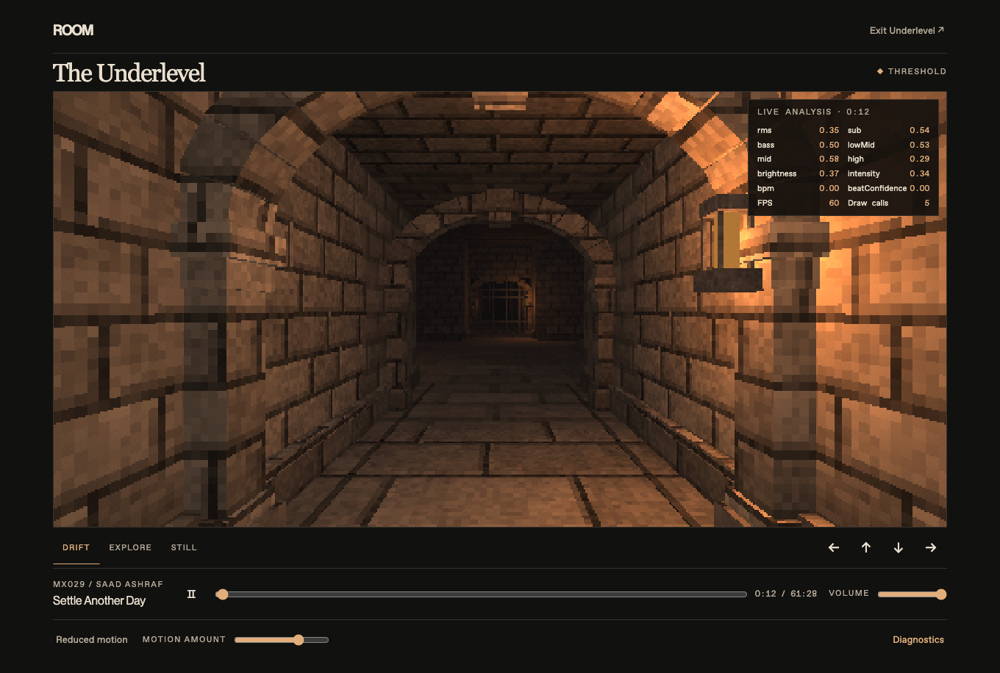
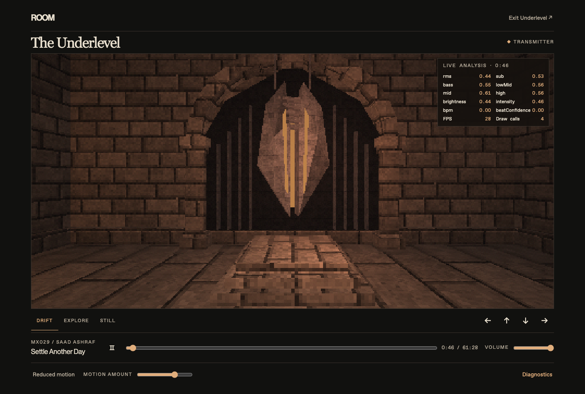
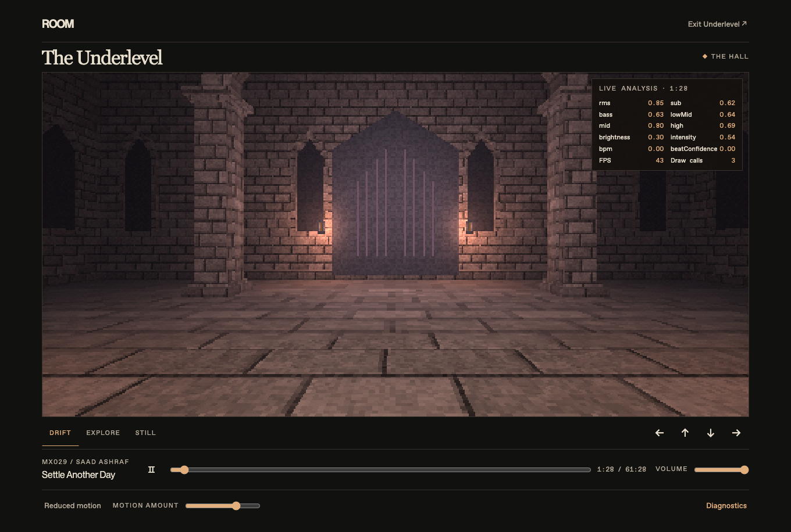
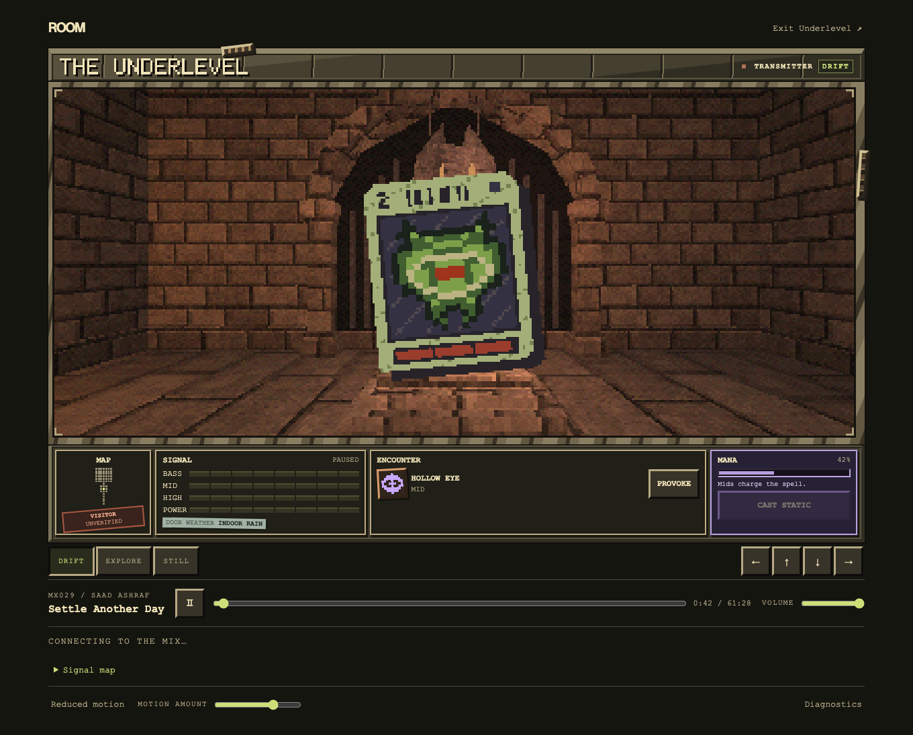
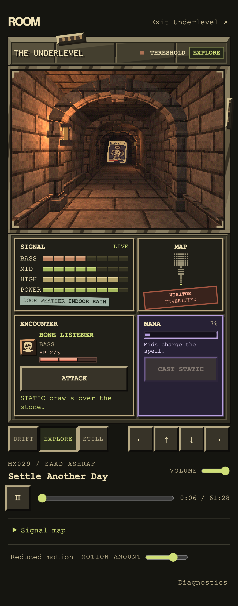
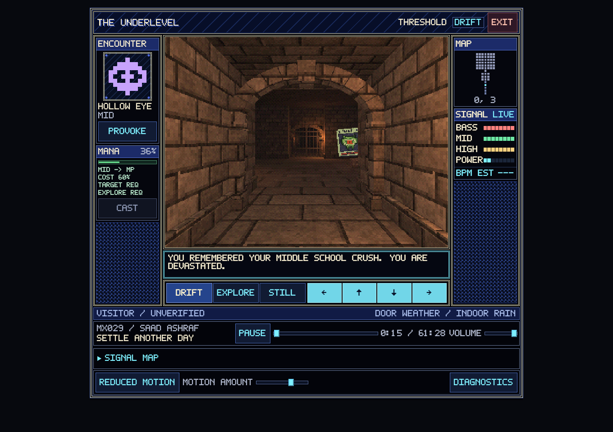
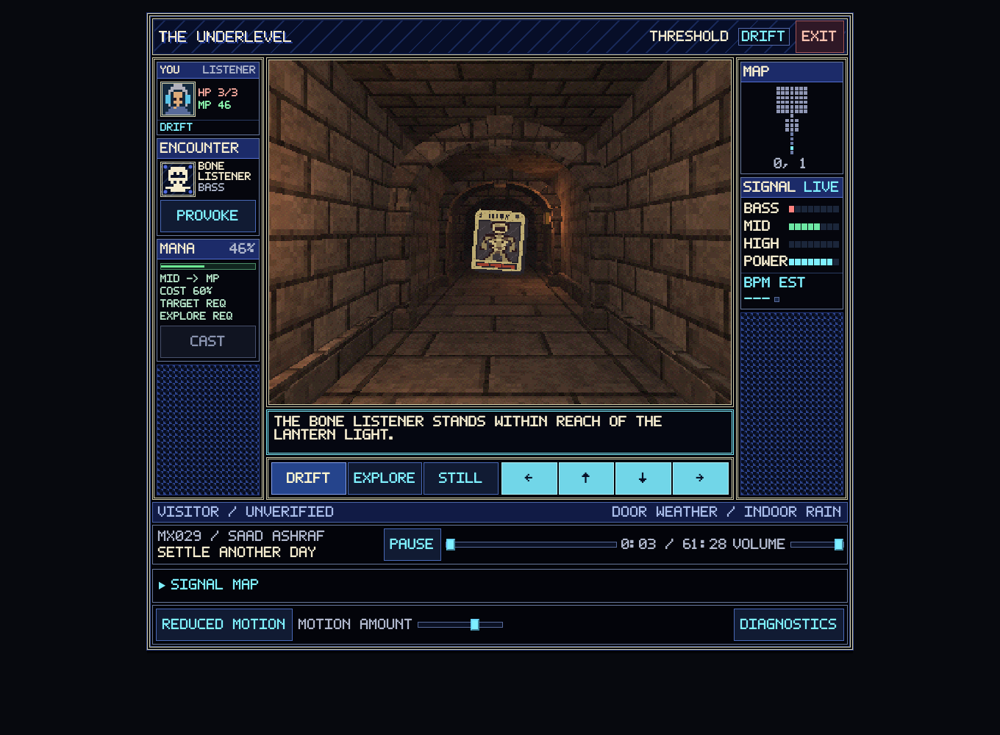

# The Underlevel — first vertical slice

**Latest revision:** contextual narration with 82 lines, a player character card, expanded BPM reactions and calibrated frequency meters in the compact DOS console. See [the UX map](UX-MAP.md) for reference notes, signal relationships and mode rules. Earlier implementation evidence below is retained as historical context; the latest revision evidence is at the end.

Open Labs → Experiences → Open The Underlevel. It runs in a full-screen modal at `/labs/#experiences`; no standalone Underlevel page is built. `/underlevel`, `/underlevel/` and `/underlevel/index.html` return 404. The existing Labs session gate controls access to the launcher.

The scene uses **MX029 — Saad Ashraf, Settle Another Day**, through ROOM's existing catalog media resolver. Press **Enter / play mix** once; DRIFT then handles the journey. The 150-second route visits the corridor, transmitter, threshold, hall, and return path. The original recording continues playing beyond this loop.

## Architecture

`src/experiences/underlevel/contracts.ts` defines the interfaces shared by five independent systems:

| System | Responsibility |
| --- | --- |
| `audio/AudioController.ts` | One existing `HLSAudioSource`, unchanged audible signal path, 30 Hz feature sampling, native Safari HLS safeguard |
| `audio/FeatureExtractor.ts` | Time-domain RMS, calibrated float-dB frequency bands, asymmetric smoothing, onset cooldown, sustained intensity, confidence-gated tempo using rolling autocorrelation |
| `world/` | Seeded decoration on fixed topology; media-clock DRIFT; 300 ms grid movement; STILL; collision-safe explicit resume |
| `director/` and `data/mx029.ts` | Replaceable cues, reconstructible chapter/gate/atmosphere state, safe gate occupancy after seeking |
| `render/` | Babylon 4.2 modular geometry, three generated 64 px materials, local shader lighting, fog, restrained dithering, gate and transmitter motion |
| `components/` | React DOM controls, accessibility, resource lifetime and fallback; status updates at 2 Hz; meters update imperatively at 12.5 Hz, without React frame updates |

Webpack uses the existing Babel pipeline with its TypeScript preset. `npm run typecheck:underlevel` runs an independent strict TypeScript check and is included in the repository check workflow. The Babylon scene is loaded separately from the entry shell. The screenshot poster appears before graphics initialization. No extra audio element is created for fallback.

## Musical direction

The first 150 seconds were decoded from the original archive stream for inspection. Two-second RMS windows measured a pronounced quiet passage at 74–77 seconds and a strong return at approximately 78 seconds. The gate begins opening at 78 seconds, is clear at 80, and the camera arrives in the hall at 86. See `live-mx029-evidence.json` for actual browser measurements around this cue.

Bass/sub shape local lantern response, midrange affects the transmitter, brightness and sustained intensity change atmosphere, and sufficiently confident tempo adds a very small cadence. These signals do not move the camera on each beat. Mood is an authored interpretation of intensity and spectral balance, not emotion recognition. Tempo is an estimate, not an offline beat grid, and uncertain passages must remain neutral.

The authored architecture repeats every 150 seconds. Only the first passage is aligned to this recording; later repetitions use the same route/cue pattern with continuing live reactive signals. Full-hour section authoring and a listening-led final cue pass remain separate work.

## Visual direction

All five original images in the supplied [Are.na channel](https://www.are.na/peter-markoski/dungeon-crawl-_v-pmazo6jw) were inspected through its public API and original image CDN on November 17, 2026. Coarse masonry, centered perspective, low ceilings, dark recesses and restricted color informed the implementation. No reference images were used as shipped textures. The world reserves amber for lantern pools and introduces bruised violet in the hall. ROOM's sparse editorial controls and existing typography frame the low-resolution world.

The three scene captures below are from the actual CDN playback run, with diagnostics enabled for evidence.

## Controls and recovery

- DRIFT is the default. Arrow keys or W/A/S/D on the focused canvas interrupt it immediately. Touch arrows offer the same movement.
- EXPLORE stays manual. After 12 seconds idle it offers Resume drift; it never takes control automatically. Resuming follows connected floor tiles around the relic.
- STILL holds the current camera pose through playback and seeking. A gate stays open while the visitor occupies its clearance.
- OS reduced motion defaults to STILL and is observed during playback until the visitor makes an explicit preference. The visible motion setting is independent.
- Native Safari HLS preserves sound and uses cue-driven visuals with analysis marked unavailable. WebGL failure/context loss leaves the poster and native controls on the same canonical audio element; Retry 3D is available.
- Pause freezes automatic travel and reactive signals. Deliberate manual exploration remains available. Tab visibility stops rendering; return reconstructs from current media time.
- Exit releases scene, audio, observers and listeners. Renderer disposal was checked twice in succession, returning Babylon engine instances from one to zero.

## Evidence and remaining limits

- Production build, strict typecheck, repository lint, 36 unit tests, and 98 HTTP routes / 96 assets passed during integration.
- The first focused cross-browser pass passed 11 checks with one intentional native-control skip across Chromium, Android emulation and mobile WebKit. The full 126-case run passed 112 with three skips; nine archive tests exposed a missing test base URL and two tests exposed stale displayed pose when OS reduced motion changed. Both causes were fixed. The final affected run passed 42 checks with three intentional skips across Underlevel, archive history and Labs. The other 81 browser cases passed in the preceding full run. No full-suite rerun was needed after the scoped fixes. Regression coverage includes paused exploration, gate occupancy and runtime reduced-motion changes.
- A continuous original-CDN run sampled 2.09–153 seconds with no directional input. All 128 samples reported a ready scene, unpaused media and readyState 4. The one recorded aborted request was an HLS segment request; playback still completed, and no page exception occurred. This establishes media continuity at sampled intervals, not a recording-based proof against every audible glitch.
- Observed rendering cost: 3–5 active draw calls, typically a 480 px maximum internal dimension. The concurrent headless run measured 10–62 FPS, median 38, while the full browser suite was running. These are software-browser observations, not evidence of meeting the 60 FPS desktop / 30 FPS physical mobile targets.
- Real mobile WebKit played MX029 with native controls, stationary reduced-motion camera, no horizontal overflow and no page exception. Physical iPhone/Android testing, orientation/device-GPU profiling and a full-hour memory/audio soak remain unverified.
- `npm audit --audit-level=low` reports seven high-severity development-tool dependency findings. An audit of untouched HEAD produced the same seven names and count; none are introduced by the TypeScript additions. The audit gate is not passing.
- Outstanding art decisions: final mix listening/cue placement, hall scale and darkness, transmitter shape/meaning, responsive intensity, and whether subsequent loops should revisit the same spaces or use additional authored passages. No larger asset library has been created.

This is a local vertical slice, not a deployment or production-readiness claim.

The continuous 153-second evidence predates the final tempo-estimator refinement; the playback, route and renderer paths are unchanged. The subsequent final-bundle CDN check ran from 70–104 seconds: it reported 50 BPM / 0.72 periodicity confidence near 92.7s and 53 BPM / 0.82 near 102.8s, alongside nonzero live bands. This demonstrates a tempo-dependent input in the live pipeline, not a verified musical beat grid. See `final-tempo-evidence.json`.

## Pixel / character-card revision — November 17

The user's later direction intentionally replaces the restrained editorial frame with crooked stone rails, a bitmap title, protruding brackets, a visitor stamp and an indoor-weather receipt. Three original tiny creature drawings are printed onto tilted world-space character cards, including cut corners, filing numbers, barcodes, printed shadows and segmented health. Each card remains one billboard mesh/texture in the 3D world. Internal render size is now capped at 384 px on its longest side, with nearest-neighbor enlargement and coarser color steps.

DRIFT and STILL actions provoke a card without damage. EXPLORE clicks or taps attack; three hits disperse it until a seek or new loop. The keyboard-accessible target button uses the same callback. A shared camera field of view excludes offscreen cards on narrow screens. Returning from a background tab preserves health within the same loop.

Mana starts at 35% and accumulates from live mids and sustained intensity. Cast static requires EXPLORE, a visible creature and 60% mana; it spends charge and briefly lights nearby cards/stone without dealing damage. Attacks remain free. Its localized effect respects reduced motion. Native Safari's existing cue-only audio path cannot recharge mana; the HUD explicitly says charge is held. Ordinary encounters, attacks and passive travel remain available there. No artificial frequency measurements are substituted.

The independent interaction controller and pure signal mapper feed both Babylon and the low-frequency React HUD. Bass drives lanterns/bones, mids drive runes/eye/mana, highs drive dust/moth, and sustained energy plus brightness shape fog. The authored 78-second reveal still anchors the architecture; these reactive mappings do not replace that cue.

Revision verification:

- Production build, strict TypeScript, repository lint, 45 unit tests, and 98 HTTP routes / 96 assets passed.
- Browser coverage validated 31 checks across desktop Chromium, Android emulation and mobile WebKit, with two intentional skips. The 33-case run passed 28; three new pointer tests initially failed due to an over-exact initial-mana assertion and a tap coordinate scrolled out of the WebKit viewport. The corrected test verifies charge remains stable while paused and scrolls the canvas into view before tapping. All three targeted reruns passed. No application workaround was needed for those test failures.
- The final real-CDN MX029 check observed all three cards along the DRIFT route at approximately 8, 42 and 86 seconds on desktop and Android emulation, with live bands and no page exception or horizontal overflow. Direct card attacks reduced health from 3 to 2. Casting reduced mana to approximately 5% and displayed the STATIC response while preserving health and EXPLORE mode. These were sampled chapter checks, not another continuous full-route soak.
- Sampled rendering cost was six draw calls. Under concurrent headless load, single FPS observations were 31 desktop / 15 Android emulation; neither is a physical-device benchmark or proof of the performance target. Physical phones and a full-hour soak remain outstanding.
- Independent review caught and resolved overly broad mobile targeting, background-playback health resets, a disconnected room-reaction mapping, and missing spell-cost/fallback explanations.

Outstanding art decisions: density of surreal labels, final creature silhouettes, card size relative to architecture, and strength of the local spell response. The first transition remains the scope boundary; no additional rooms or asset library were added.

## DOS reference correction, tempo and narration — November 17

Reinspected all five original Are.na images through the public API/CDN. The primary card-dungeon screenshot, Dungeon Master and Elvira II informed a compact console: central 4:3 scene, narrow portrait/mana and map/signal columns, black command and narration areas, thin ivory/blue boundaries and cyan controls. The previous broad panels, Courier type and crooked sticker framing are replaced. Surreal details now read as terse status text. The original 2.8 KB bitmap font is self-hosted at `assets/underlevel-dos.woff`, with reproducible glyph source in `scripts/assets/build-underlevel-font.py`; no reference art or third-party font was shipped.

Visual tokens are scoped to this experience: 16 px bitmap body lettering, smaller compact mana readouts, near-black `#080910`, ivory `#f4ebce`, cyan `#7ff0ff`, and blue `#233578`. Touch/keyboard controls retain 44 px targets. Desktop has three columns; phone layout places the viewport, text and movement first, with instruments below. The 780 px check retained a 476 × 355 px canvas without horizontal overflow.

Confident tempo estimates modulate localized torch contribution by at most ±16%, with warm/cool color drift over eight estimated beats. Above 150 BPM, brightness runs every two beats. The audio pipeline integrates separate beat and pulse phases so small BPM corrections and crossing the 150 BPM threshold do not flip the lights abruptly. Seek/pause analysis resets restart phase. This is estimated-period modulation, not onset-aligned beat tracking. Weak estimates, paused/unavailable analysis, reduced motion and zero motion amount disable tempo modulation.

The original-CDN check sampled 29 frames across the passage after 78 seconds. Estimates included 49–54 BPM, and nonzero tempo responses were observed; many samples remained neutral because confidence was insufficient. Reduced motion produced zero tempo pulse and color. See `dos-tempo-evidence.json`. Half/double-time ambiguity and limited confidence remain audible-material-dependent; no verified beat grid is claimed.

Ten narration windows per 150-second passage alternate dungeon guidance with the user's five supplied intrusive thoughts verbatim. Quiet gaps separate them. The text follows media time, holds when paused and repeats consistently after seeking/looping. It has no typing animation or automatic screen-reader announcements. `director/Narration.ts` owns timing and copy independently of React/Babylon.

Final checks: production build, strict typecheck, lint, 52 unit tests and 34 browser checks passed, with two intentional browser skips. Browser coverage spans desktop Chromium, Android emulation and mobile WebKit, including narration pause/seek/repeat behavior. Actual-MX029 captures verified font loading, desktop/tablet/mobile fit, no horizontal overflow and no page errors. Independent review passed the DOS reference-fidelity and narration-fit scope. Physical device profiling remains unverified. This is still local and uncommitted, not deployed.

## Adaptive messages, player and frequency response — November 17

The narration director now has 82 lines selected from actual location, visible creatures, attacks, defeats, casting and live sonic conditions. It retains all five user-supplied thoughts verbatim. Quiet passages and sustained builds can queue a message; bass-heavy, bright and fast passages affect eligibility. This is spectral/intensity interpretation, not emotion recognition. Lines hold for 7–9 seconds with 6–10 second gaps. The previous 14 lines are excluded from selection; history continues across route loops. Explicit seeks reset the seeded selector, while ordinary loops no longer replay a fixed script. Pause holds the current text.

The player card shows an original pixel listener wearing headphones, HP 3/3, shared mana and the current mode. HP is intentionally static because creatures do not automatically damage the visitor. The headphone accent follows the same confident tempo pulse as the beat indicator. Tempo now also shapes transmitter breathing, discrete creature poses, rune accents and dust, in addition to localized lights. Reduced motion and zero motion disable these automatic effects.

The flat bands came from normalizing every band against its own recent average, which caused sustained signals to converge, combined with byte-spectrum clipping. The analyser now reads floating-point dB values. Each band combines mean and peak power, then applies its own display range: sub −78 to −21 dB, bass −76 to −24, low-mid −74 to −27, mid −77 to −31 and highs −87 to −43. A 0.005 RMS silence gate and 50 ms attack / 160 ms release keep the response bounded. These are visual calibration ranges, not calibrated sound-pressure measurements. The audible signal path is unchanged.

A production-bundle check against the original MX029 CDN recorded 165 desktop samples at approximately 200 ms intervals. The eight-segment meters changed 52 times for bass, 80 for mids, 82 for highs and 40 for power, with different ranges across bands. Dungeon-context messages changed as DRIFT moved from the bone listener through the eye/transmitter area. Desktop and Android-emulated captures had no page errors or horizontal overflow. See `adaptive-live-evidence.json`. This verifies movement with the real mix; it is not a full-route performance benchmark or a beat-grid accuracy claim. Native Safari still uses its explicitly labeled cue-only safeguard and cannot provide live FFT or mana recharge.

A second final-bundle CDN check sampled 78–108.6 seconds: 27 of 58 samples had nonzero tempo modulation, with estimates of 48–56 BPM. Reduced motion returned the pulse to zero and selected STILL. See `adaptive-tempo-evidence.json`. These estimates demonstrate periodic response; half/double-time ambiguity remains and musical BPM accuracy is not established.

Verification: 57 unit tests and 37 focused browser checks passed, with two intentional browser skips; strict TypeScript, lint, production build and 98 route / 96 asset checks passed. The final compact-sidebar adjustment was visually rechecked on desktop and Android emulation with no page errors or horizontal overflow. Independent source review found no actionable defects. Physical-device profiling and full-hour playback remain unverified. Changes remain local and uncommitted.

## Labs modal integration — November 17

The standalone entry document and route were removed. Labs lazy-loads the experience into a full-screen native dialog only after selecting its launcher. Escape, Back to Labs and Exit dismiss it; dismissal unmounts the scene and audio controller, unlocks scrolling and restores focus to the launcher. Background Labs controls remain inert while the dialog is open. Reloading stays in Experiences without reopening the modal. Loading and failure states retain a close control.

Dungeon typography, colors and controls are scoped to its own shell so loading the experience cannot restyle Labs. The existing Labs session gate remains a client-side discovery barrier, not server-side authentication. The production routing function explicitly rejects the retired page and HTML URL; no public experience page is emitted.

Modal validation: production build, strict typecheck, lint, 58 unit tests and 99 route / 94 asset checks passed. The Labs/Underlevel browser run passed 50 checks with four intentional skips; six new assertions initially failed because the fixture re-authenticated on reload and the focus test incorrectly rejected native tabbing into browser chrome. Corrected tests verify sign-out, inert background controls, Escape/Exit cleanup and focus restoration; all six reruns passed across Chromium, Android emulation and mobile WebKit. No application change was needed for those test failures. The local in-app browser visibly confirmed the full-screen modal and unchanged Labs URL. Still local, not deployed.

## PR integration on current master

Prepared against master `0c504c7`, retaining the existing Labs playground, persistent player and dependency-policy changes. The modal now creates a fresh lazy component per opening so closing and reopening retries a transient download failure; the regression failed before the fix and passes afterward. Independent review is clear.

Final candidate validation: clean `npm ci`; 70 unit tests; lint; strict Underlevel typecheck; production build; 99 routes / 94 assets; and 59 focused Labs/Underlevel browser checks passed with four intentional skips across Chromium, Android emulation and mobile WebKit. The existing dependency policy passes with seven documented development-only findings under its unchanged exception. Raw audit is not clean. Prior real-MX029 evidence remains above; this integration did not repeat the full recording soak. Full repository browser coverage will also run in hosted CI.
