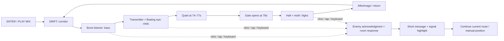

# Underlevel — encounter and signal UX map

Direction: cheap, crude, deliberate. The latest correction calls for period DOS screen composition rather than a modern retro dashboard: a compact central dungeon window, narrow status/portrait columns, black command areas, actual bitmap lettering and restricted cyan/ivory/red/green UI colors. Floating character cards and surreal weather/status text remain. The user's November 17 revisions supersede the original TTD exclusion of enemies and its contemporary editorial framing. DRIFT/STILL provoke; EXPLORE attacks. Encounters remain optional; DRIFT is still a complete experience.

## Reference correction

Reinspected all five original images in [the supplied Are.na channel](https://www.are.na/peter-markoski/dungeon-crawl-_v-pmazo6jw) on November 17, using its public channel API and original image CDN. The primary composition reference is block 23696642 (portrait columns around a dungeon/card viewport, black text-command area, thin ornamental ivory/blue frame). Block 14658275, Dungeon Master, contributes cyan directional controls and colored status bars; block 28184731, Elvira II, contributes the tightly integrated frame and small icon compartments. Block 51612953 contributes stark bitmap text and a restricted palette. The Bowser-jail meme is environmental/surreal context, not the DOS interface source. Reference artwork is not shipped in the app.

## Entry and dismissal

Labs → Experiences → Open The Underlevel opens a full-screen modal without changing the URL. Enter / play mix remains the explicit audio gesture. Escape or Exit stops playback, releases the renderer and returns focus to the launcher. Refresh does not reopen it. The former `/underlevel/` page returns 404.

## Journey

The dashed interaction is an overlay on the ongoing journey, not a navigation jump. Input never seeks the mix or changes camera mode. Movement keys still select EXPLORE; STILL freezes the camera. Enemies do not block tiles or require defeat. DRIFT/STILL actions acknowledge; EXPLORE actions attack. Three hits disperse an enemy for the current loop. A short attack cooldown prevents strobing. Seeking or starting a new loop restores encounters deterministically.

## Screen anatomy

- **Console frame:** bitmap title, chapter and mode inside thin ivory/blue lines; a central 4:3 viewport with narrow portrait and instrument columns. Phone layout stacks viewport, narration and commands above the panels.
- **Dungeon viewport:** coarse color steps and visible pixel texture; three world-space billboard character cards with tilted cut corners, printed shadows, filing numbers, barcodes and health segments. Bounded audio animation; shared perspective keeps offscreen cards untargetable.
- **Signal rail:** BASS / MID / HIGH / POWER stepped bars showing normalized analysis. Explicit cue-only / paused state when live samples are unavailable; no fake FFT.
- **Player card:** original pixel listener portrait, static HP 3/3, shared MP and current navigation mode. Headphones catch the confident tempo pulse; reduced motion keeps them still.
- **Target plate:** current encounter, its linked signal, portrait and segmented health bar in EXPLORE, and an accessible Provoke/Attack button mirroring click/tap on the card.
- **Mana plate:** starts at 35%; live mids (65%) and sustained intensity (35%) replenish it at up to 8% per second. EXPLORE's Cast static spends 60% to provoke visible cards and bend nearby light, without damage. It shares the 650 ms action cooldown. Pause and cue-only playback hold charge; explicit seek/new loop restores starting charge. Ordinary attacks cost no mana.
- **Message log:** one short acknowledgment, with polite assistive announcement only for deliberate interactions. No scrolling combat spam.
- **Map plate:** coarse authored floor plan and current position; no quest marker or inventory.
- **Transport:** real playback, seek, volume, exit and motion controls keep their existing semantics.
- **Narration window:** a reserved black text area immediately below the viewport. 82 lines combine actual location, visible encounters, attacks/defeats/casts and sonic conditions with surreal thoughts, including the user's five exact lines. Lines hold 7–9 seconds with 6–10 second quiet gaps. The previous 14 lines cannot repeat, and history persists across route loops. Explicit seeks reset the seeded selector; pause holds the current message. No typing animation, blinking, forced screen-reader announcements or interaction requirement.

## Element → signal → feedback

| Element | Passive music response | Deliberate action | Feedback | Quiet / pause / reduced motion |
| --- | --- | --- | --- | --- |
| Lanterns | Smoothed bass/sub shapes amplitude; confident estimated tempo adds smooth localized brightness pulses and warm/cool hue drift over eight beats | None | Visible light pools pulse once per estimated beat, or every two beats above 150 BPM; brightness modulation bounded to ±16% | Tempo modulation is zero when paused, low-confidence, cue-only, reduced-motion or motion amount zero |
| Bone listener | Bass changes a few coarse pose frames / body scale | Provoke in DRIFT / attack in EXPLORE | Flinch, one-line reply, brief local amber response | Still silhouette; acknowledgment without shake |
| Floating eye | Midrange changes pupil / rune brightness | Provoke in DRIFT / attack in EXPLORE | Eye opens, glyph response and reply | Static pose, bounded color change |
| Moth | Highs change sparse particles and wing pose; confident tempo accents dust and coarse wing steps | Provoke in DRIFT / attack in EXPLORE | Wing response and dust motes | No automatic flutter in reduced motion |
| Transmitter / runes | Midrange and sustained intensity lift seams; confident tempo adds transmitter breathing and opposing rune accents | Enemy acknowledgment briefly boosts the local response | Observable correspondence between bar and object | Low static emission |
| Fog / palette | Slow intensity and spectral brightness change density and color weight | Acknowledgment decays back into the mix | Slow mood change, no full-screen flash | Cue-derived ambient state if analysis unavailable |
| Gate | Low-mid resonance is small; authored 78s cue controls opening | No mandatory action | Musical return makes architecture change | Safe occupancy handling remains active |
| Cadence | Confident estimated periodicity affects light-pool cadence and tiny discrete enemy poses | None | Lighting phase advances with elapsed media time and stays continuous as BPM estimates change. It restarts when analysis resets after seeking and follows the estimated period without tracking beat onsets. | Tempo modulation stops on pause and in reduced motion |
| HUD meters | Same calibrated float-dB band frame used by world mappings, updated imperatively at 12.5 Hz | Signal map disclosure explains each relationship | Stepped level marks, explicit data source | Zero/paused or labeled cue state |
| Mana | Live mids and sustained intensity accumulate charge | Cast static in EXPLORE at 60% charge | Card response, STATIC message and localized warm stone/rune light | Holds charge; no fabricated fallback analysis |
| Visitor status / door weather | Static surreal decoration | None | UNVERIFIED identity and INDOOR RAIN | Always static; no interaction implied |
| Player portrait | Shared confident tempo pulse highlights headphones | Mode controls and casting update mode/MP | HP 3/3, live shared mana and explicit mode | No glint under reduced motion or zero motion |
| Bottom narration | Quiet/build events plus current bass, brightness and tempo select eligible lines; actual tile and encounters supply context | Attack, defeat and cast events enter the message queue | 82-line pool; last 14 excluded; readable holds and quiet gaps | Held during pause; no animation; loop history retained; explicit seek resets |

## Implementation and acceptance

Keep the mapping in one pure `SignalMapper` module. Encounter state is independent of Babylon and React; rendering consumes it. React HUD status remains at 2 Hz; meter segments and the beat indicator update imperatively at 12.5 Hz, while world transforms use refs. Float-dB power bands use separate display ranges and 50 ms attack / 160 ms release, preserving frequency differences instead of independently flattening each band against its own rolling average. Click picking and keyboard target buttons invoke the same callback. Pause, seek, repeat and exit clear stale transient reactions safely. Enemies are deterministic placed sprites, not random spawns.

Acceptance: three visible enemy types encountered hands-off; click and keyboard interaction produce identical acknowledgment; continued music/camera ownership; same signal changes its meter and mapped object; reduced-motion stationary behavior; no horizontal overflow on phone; static/native fallback still usable. The visual baseline is intentionally crude, but focus, hit areas, and state labels remain legible.
